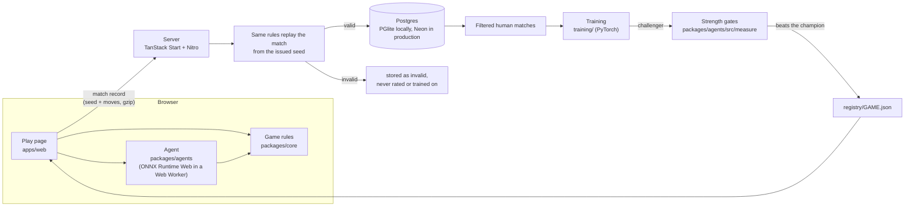

# Duelwise

**Can you beat my agents?**

Seven games. Four opponents. Agents that learn.

Pick a game and sit down across from Pip, Marlow, Vesper or Sable. Pip is easy to beat. Sable is not. Every match runs in your browser, every strength number comes from matches we actually played, and a level we could not prove is stronger than the one below it is labelled Practice instead of getting a number.

Duelwise is a working name. It lives in one file, `packages/core/src/product.ts`.

## What it is

Seven games, each with a built-in opponent at four levels:

| Game | What it is |
|---|---|
| Chess | The full game. |
| Four in a Row | Drop discs, line up four. |
| Heads-Up Hold'em | Two-player poker, heads up. |
| Word Duel | Guess the hidden word in a duel. |
| Tinderbox | A 2.5D fighter. Real time. |
| Coldstore | A first-person arena shooter. Real time. |
| Stormglass | Hidden fleets on a ten by ten grid. Find theirs first. |

The four opponents are the same four people in every game, one per level:

| Level | Opponent |
|---|---|
| Easy | Pip |
| Medium | Marlow |
| Hard | Vesper |
| Champion | Sable |

Each opponent plays in its own style per game (`apps/web/src/personas/personas.json`).

Every finished match is stored as a small replayable record: the seed and the moves. The server replays the record from the seed it issued, and only a record that replays cleanly counts toward ratings or training.

## Play it

The live site is not deployed yet. When it is, the link goes here: **[deployed URL placeholder]**.

On a phone, Tinderbox and Coldstore have touch controls, and the app installs and plays with no signal (see "Run locally" for how to try that on your own machine, and the roadmap for what is not tested yet).

## Where the learning comes from

"Agents that learn" is true, but it is not equally true for every game. This is the honest version, from the code and the registry files at this commit.

| Game | How the agent got its strength | Trains on human matches today |
|---|---|---|
| Four in a Row | Self-play (AlphaZero style) with search on top. It has a retraining loop that exports filtered human matches, trains a challenger and promotes it only if it beats the current champion. | Wired, yes. It is the only game that is. No promoted version has used any human match yet (`humanMatchesUsed` is 0 in `four.json`). |
| Chess | Neural nets trained on public Lichess games, plus a value net and self-play data. Easy and Medium imitate the moves of players in a rating band. | No |
| Heads-Up Hold'em | A strategy table built by counterfactual regret self-play (millions of iterations), cut into levels by training length. | No |
| Word Duel | A solver, not a learned model. Levels differ in how often the solver overlooks a clue. | No (nothing to train) |
| Tinderbox | A neural policy trained by reinforcement learning in a league of its own past versions, with scripted test bots as the yardstick. | No |
| Coldstore | The same method as Tinderbox. | No |

"Learning from you, starting with Four in a Row", the line on the product, is where this stands. Making human matches train all seven is on the roadmap.

## How it works



- **`packages/core`** (TypeScript): seven deterministic, seeded, headless game simulations behind one `GameCore` interface, the match record format, replay, Elo and the human input limiter. The same code runs in the browser, on the server and in training.
- **`packages/agents`** (TypeScript): the browser agent runtime, search and strategy code per game, level configs, the measurement harness, and `registry/<game>.json`, the file every strength number is read from.
- **`apps/web`**: TanStack Start on Vite and Nitro, React 19, Tailwind 4. Drizzle on PGlite locally and Neon in production, Better Auth for Google and GitHub sign-in (optional, play works as a guest), Sentry in the browser. An installable offline app (service worker, queued uploads) is described in `docs/offline.md`.
- **`training`** (Python 3.12, PyTorch): one supervisor that runs resumable, niced jobs under a CPU and GPU budget, a trainer per game, ONNX export, and the evaluation ladder that writes the registry.

## Honest strength

A strength number is a claim, so each one has to be earned.

- **Strength gates.** Each level plays the one below it, from both seats, with seats swapped every game, for up to 400 games (200 for chess). A level is published only if its score has a 95% Wilson lower bound above 50% against the level below, and every level under it passed too. If Hard cannot beat Medium, then Hard and Champion both wait.
- **Site Elo.** A published level shows a number such as "site Elo 1000". Easy is fixed at 1000 and each higher level is the chained gap from its head-to-head score. It measures our levels against each other. It is not a chess rating and not comparable to any outside scale.
- **Practice levels.** A level that did not clear its gate is still playable. It is marked **Practice**, shows no strength number, and a rating earned against it is marked provisional. Today, for example, Hold'em Champion is Practice, and Coldstore Medium and Hard are Practice.
- **Gates are checked twice.** The measurement writes the evidence into the registry, and the web app re-checks that evidence (`apps/web/src/lib/strength-gates.ts`) before it shows a number. For the fighter and the shooter the evidence includes beating a named set of scripted bots from both seats.
- **Published today**, from the registry files at this commit (the web app's second check can only remove a level, never add one): Four in a Row, Chess, Word Duel and Tinderbox at all four levels; Hold'em at Easy, Medium and Hard; Coldstore at Easy and Champion.
- **Known limit.** Chess strength is on our own ladder only. It is not anchored to an outside engine rating until a Stockfish-anchored ladder has been run.
- **Privacy.** Matches are used for training on a legitimate-interest basis with an opt-out (a notice before the first match, and a switch). It is one config switch to make it opt-in.

The full list of limits and what is planned is in the roadmap below. Numbers in this README are not typed in by hand where they could drift; the registry files are the source.

## Run locally

Needs Bun. Python 3.12 only if you train.

```
bun install
bun run dev
```

The dev server listens on `PORT`, or on a port chosen from the worktree folder name. Local data lives in a PGlite database under `.data/pglite` in the repo's common root. No environment variables are needed to play; the names for sign-in, production and tests are in `.env.example`. With `DEV_LOGIN=1` a dev-only sign-in appears.

Checks (run one file or spec at a time; the whole-repo `bun test` loads native modules that clash in one process):

- One TypeScript file: `bun test <file>`
- Types: `bun run typecheck`
- One browser spec, from `apps/web`: `bunx playwright test <spec> --workers=1`
- One Python file: `scripts/py -m pytest -q <file>` (`scripts/py` uses the shared training venv)
- Guards (banned terms, dashes, honest numbers): `bun run guards`
- Whole suite, every file alone: `python3 scripts/run_suite.py --label <label>`

To try the installable offline app you need a production build, because the service worker is registered only there. `bun run smoke` checks a local production build.

Deploying (Neon, Vercel, sign-in) is in `docs/deploy.md`, and the commands to run after an overnight build are in `docs/morning-checklist.md`.

Repo layout:

- `packages/core`: deterministic game sims and shared contracts
- `packages/agents`: browser agent runtime, registry, measurement
- `apps/web`: the web app
- `training`: Python trainers (package `trainer`)
- `scripts`: paths, guards, suite runner
- `docs`: guides, design notes and third-party credits

## Add a game

Anyone should be able to add a game, give it opponents and have them measured honestly. The guide is **[docs/add-a-game.md](docs/add-a-game.md)**. It walks through a small example game, Cairn (a take-away counting game, in `packages/core/src/games/template/`), covering the interface, the agent, the measurement, the registry, the strength gates and the pull request. You can play Cairn on a dev server at `/dev/cairn`. It is hidden from players.

Bug reports and pull requests are welcome. See **[CONTRIBUTING.md](CONTRIBUTING.md)**.

## Roadmap

Built in this repo, not yet proven on real devices or at launch scale:

- **Offline app.** Installable, plays with no signal, saves matches on the device and sends them when you are back online. Passes its production-build test. Not tried on a real iPhone or Android, and Safari has no background sync, so it sends on the next open.
- **Phone.** Touch controls for Tinderbox and Coldstore. Checked with flat test shapes, not the real 3D art on a phone.

Planned:

- Human matches train all seven games, with the same filter and promote-only-if-it-wins gate Four in a Row has.
- Tournament mode.
- Community games: open the platform so anyone can add a game and have agents learn it (the guide above is the first step).
- A native app.
- Anchored chess strength against an outside engine.

## License

The code is MIT licensed (see `LICENSE`). Third-party assets keep their own licenses, listed in `THIRD_PARTY.md` and `docs/third-party/`. One purchased animation pack is not in this repository and never will be: the site loads it from separate storage, and without it the opponent uses the free clips that are included, so a clone runs as is. To use your own animations, see `quaternius-paid.md`.
