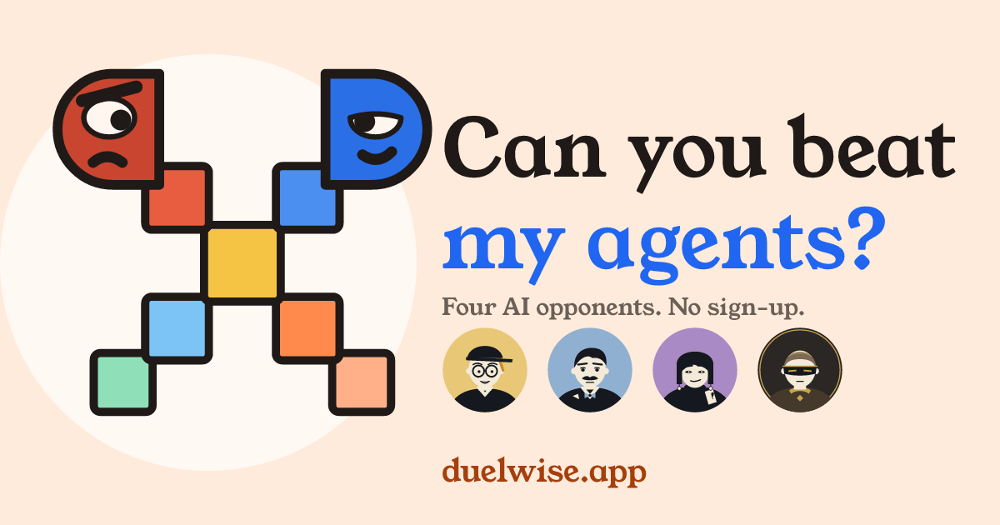
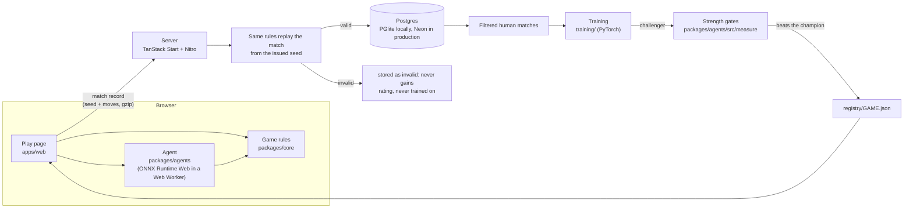

# Duelwise

[](https://duelwise.app)

**Can you beat my agents?**

Ten games. Learning from you, starting with Four in a Row. Beat them if you can.

**[Play now at duelwise.app](https://duelwise.app)**. No sign-up and no email: a name is enough. Google or GitHub sign-in is optional.

Pick a game and sit down across from Pip, Marlow, Vesper or Sable. Pip is easy to beat. Sable is not. Every match runs in your browser, every strength claim comes from games actually played, and a level that has not proved it beats the one below is labelled **In training** instead of getting a number.

## The games

Ten games, each with a built-in opponent at four levels:

| Game | What it is |
|---|---|
| Chess | The full game. |
| Four in a Row | Drop discs, line up four. |
| Heads-Up Hold'em | Two-player poker, with play chips only. |
| Word Duel | Guess the hidden word in a duel. |
| Tinderbox | A 2.5D fighter. Real time. |
| Coldstore | A first-person arena shooter. Real time. |
| Stormglass | Hidden fleets on a ten by ten grid. Find theirs first. |
| Crosscurrent | Close a line of their discs between two of yours and it flips. Most discs wins. |
| Twelve Yards | A penalty shootout. Five kicks each, nine spots to shoot at, five dives to save. You pick at the same moment. |
| Glasscut | Air hockey. Real time, first to 7 goals. Drag to move your mallet, on a phone or with a mouse. |

The four opponents are the same four characters in every game, one per level, each with its own style per game (`apps/web/src/personas/personas.json`):

| Level | Opponent |
|---|---|
| Easy | Pip |
| Medium | Marlow |
| Hard | Vesper |
| Champion | Sable |

## What you can do

- **Climb the path.** Beat a level once to unlock the next: Pip, then Marlow, then Vesper, then Sable.
- **Play rated or Practice.** Rated is the default. Practice is the same game, unrated, and nothing on your record changes.
- **Get on the board.** Each game has a 30-day leaderboard with a column for each opponent, ranked by wins. Guests are on it. Sign in to earn an Elo rating as well (Tinderbox and Coldstore do not change a rating yet).
- **Read your match report.** A finished match gets a report with the result, how the game went and its key moments. Share the link or a card image, or turn the link off.
- **See the agents.** [The AI page](https://duelwise.app/ai) shows every opponent in every game and how strong each one measured. Each game also has a stats page with head-to-head scores, version history and how often people win.
- **Play anywhere.** Tinderbox and Coldstore have touch controls on a phone. The site installs as an app and plays with no signal, then sends your matches when you are back online.

## Where the learning comes from

"Learning from you" is true, but it is not equally true for every game. This is the honest version, from the code and the registry files.

| Game | How the agent got its strength | Trains on human matches today |
|---|---|---|
| Four in a Row | Self-play (AlphaZero style) with search on top. It has a retraining loop that exports filtered human matches, trains a challenger and promotes it only if it beats the current champion. | Wired, yes. It is the only game that is. No promoted version has used any human match yet (`humanMatchesUsed` is 0 in `four.json`). |
| Chess | Neural nets trained on public Lichess games, plus a value net and self-play data. Easy, Medium and Hard imitate the moves of players in a rating band. Champion searches ahead using the value net. | No |
| Heads-Up Hold'em | Strategy tables built by counterfactual regret self-play. Easy, Medium and Hard come from one 250,000 iteration run with different playing habits. Champion uses a finer table from 5 million iterations and beats Hard from both seats. | No |
| Word Duel | Solvers, not learned models. Easy sometimes overlooks a clue, Medium favours common words, Hard picks the most informative guess and Champion looks two steps ahead. | No (nothing to train) |
| Tinderbox | A neural policy trained by reinforcement learning in a league of its own past versions, with scripted test bots as the yardstick. Easy, Medium and Hard share one network under different limits, and Champion has its own. | No |
| Coldstore | A neural policy trained by reinforcement learning against scripted test bots and its own past versions. Easy and Medium share one network under different limits (no network trained for Medium beat Easy head to head), Hard and Champion each have their own. | No |
| Stormglass | A scripted solver, not a learned model. Each level is a different algorithm. | No (nothing to train) |

Making human matches train every learned agent is planned, under "What's coming next".

## How it works



Every finished match is stored as a small replayable record: the seed and the moves. The server replays the record from the seed it issued, and only a record that replays cleanly can gain rating or reach training. An invalid record never gains rating and is never trained on.

- **`packages/core`** (TypeScript): seven deterministic, seeded, headless game simulations behind one `GameCore` interface, the match record format, replay, Elo and the human input limiter. The same code runs in the browser, on the server and in training.
- **`packages/agents`** (TypeScript): the browser agent runtime, search and strategy code per game, level configs, the measurement harness, and `registry/<game>.json`, the file every strength number is read from.
- **`apps/web`**: TanStack Start on Vite and Nitro, React 19, Tailwind 4. Drizzle on PGlite locally and Neon in production, Better Auth for optional Google and GitHub sign-in, Sentry in the browser. The installable offline app (service worker, queued uploads) is described in `docs/offline.md`.
- **`training`** (Python 3.12, PyTorch): one supervisor that runs resumable, niced jobs under a CPU and GPU budget, a trainer per game (package `trainer`), ONNX export, and the evaluation ladder that writes the registry.
- **`scripts`** holds paths, guards and the suite runner. **`docs`** holds guides, design notes and third-party credits.

## Honest strength

A strength number is a claim, so each one has to be earned.

**Strength gates.** A level is published only if it clears its gate, and the gate fits the game. Below, "beat" means a 95% Wilson lower bound above 50%.

| Game | What a level must do |
|---|---|
| Chess | Beat the level below from each seat over 400 games per seat (Easy plays a random mover). Hard must also clear a score bar against a 2-ply bot. |
| Four in a Row | Beat the level below in up to 400 games (Easy plays a random mover), stopping early at 100 or 200 only on a stricter 99% bound. A new champion version must beat the old one over at least 400 games with a score of at least 55%. |
| Heads-Up Hold'em | Beat the level below over 1000 deals, each played twice with the seats swapped, overall and from each seat (Easy plays an always-call bot). |
| Word Duel | Play all 1,975 answer words and average fewer guesses than the level below, with 95% intervals that do not overlap. |
| Tinderbox, Coldstore | Clear a bar set for that level against every scripted bot, over 400 matches on each seat. Then beat the next published level below over 400 matches with the seats swapped. |

In Chess, Four in a Row, Hold'em and Word Duel, every level under a level must pass too: if Hard cannot beat Medium, then Hard and Champion both wait. Coldstore compares against the next published level below instead, so a level that fails the rule waits alone and the ones above it can still publish.

- **Site Elo.** In Chess, Four in a Row, Hold'em and Word Duel a published level shows a number such as "site Elo 1000". Easy is fixed at 1000 and each higher level is the chained gap from its head-to-head score. It measures our levels against each other. It is not a chess rating and not comparable to any outside scale. Tinderbox and Coldstore say in plain words what was measured instead.
- **In training levels.** A level that has not cleared its gate is still playable. It is marked **In training** and shows no strength number, a rating earned against it is marked provisional, and its leaderboard column shows a player count instead of ranks.
- **Gates are checked twice.** The measurement writes the evidence into the registry, and the web app re-checks that evidence (`apps/web/src/lib/strength-gates.ts`) before it shows a number. That second check can only remove a level, never add one.
- **Published today.** 24 of 24 levels: every game at all four levels.
- **Known limit.** Chess strength is on our own ladder only. It has not been anchored to an outside engine yet.
- **Privacy.** Matches can train the agents on a legitimate-interest basis, with an opt-out: a notice before your first match and a switch that starts on. Turning it off also takes your earlier matches out of training exports. One config value (`trainingDataBasis` in `packages/core/src/product.ts`) makes it opt-in. The site stores no IP addresses and runs no third-party analytics. The full policy is at [duelwise.app/privacy](https://duelwise.app/privacy).

The registry files are the source for the strength results in this README.

## What's coming next

A new game is in progress: **8-Ball**.

Also planned:

- Human matches train every learned agent, with the same filter and promote-only-if-it-wins gate Four in a Row has.
- Stronger Hard opponents as real matches come in.
- Anchored chess strength against an outside engine.
- Tournament mode.
- Community games: open the platform so anyone can add a game and have agents learn it (the guide under "Contributing" is the first step).
- A native app.

Built, but not fully proven yet:

- **Offline app.** Installable, plays with no signal, saves matches on the device and sends them when you are back online. It passes its production-build test, and wider testing on real devices is still to do. Background Sync exists only in Chromium, so other browsers send on the next open. Offline Word Duel is unranked and counts only on that device.
- **Phones.** Touch controls for Tinderbox and Coldstore are built, and the site has had launch checks on real phones. Coverage across devices is still small.

## Run locally

Needs Bun. Python 3.12 only if you train.

```
bun install
bun run dev
```

The dev server listens on `PORT`, or on a port chosen from the checkout's folder name. Local data lives in a PGlite database under `.data/pglite` in the repo's common root. No environment variables are needed to play; the names for sign-in, production and tests are in `.env.example`. With `DEV_LOGIN=1` a dev-only sign-in appears.

Checks (run one file or spec at a time; the whole-repo `bun test` loads native modules that clash in one process):

- One TypeScript file: `bun test <file>`
- Types: `bun run typecheck`
- One browser spec, from `apps/web`: `bunx playwright test <spec> --workers=1`
- One Python file: `scripts/py -m pytest -q <file>` (`scripts/py` uses the shared training venv)
- Guards (banned terms, dashes, honest numbers): `bun run guards`
- Whole suite, every file alone: `python3 scripts/run_suite.py --label <label>`

To try the installable offline app you need a production build, because the service worker is registered only there. `bun run smoke` checks a local production build.

Deploying (Neon, Vercel, sign-in) is in `docs/deploy.md`.

## Contributing

Contributions are welcome. New games and clear bug reports help most.

You can add your own game. The opponents do not need machine learning: a rule-based bot is fine, as long as each level proves it beats the one below. **[docs/add-a-game.md](docs/add-a-game.md)** walks through a small example, Cairn (a take-away counting game in `packages/core/src/games/template/`), covering the interface, the agent, the measurement, the registry, the strength gates and the pull request. You can play Cairn on a dev server at `/dev/cairn`. It is hidden from players.

**[CONTRIBUTING.md](CONTRIBUTING.md)** covers bug reports, what a new game needs and how pull requests work.

## License

The code is MIT licensed (see [`LICENSE`](LICENSE)). Third-party assets keep their own licenses, listed in [`THIRD_PARTY.md`](THIRD_PARTY.md) and [`docs/third-party/`](docs/third-party/). One purchased animation pack is not in this repository and never will be: the site loads it from separate storage, and without it the opponent uses the free clips that are included, so a clone runs as is. To use your own animations, see [`docs/third-party/quaternius-paid.md`](docs/third-party/quaternius-paid.md).
